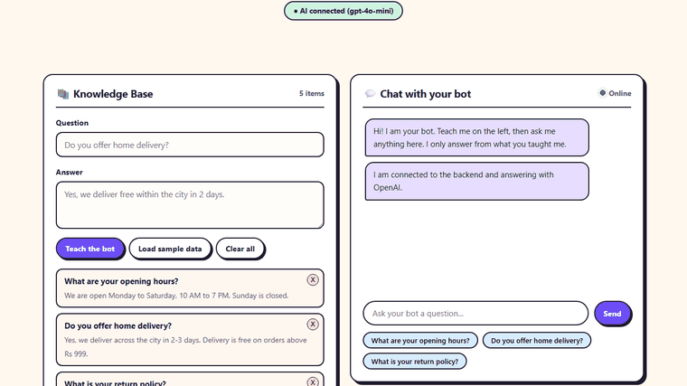
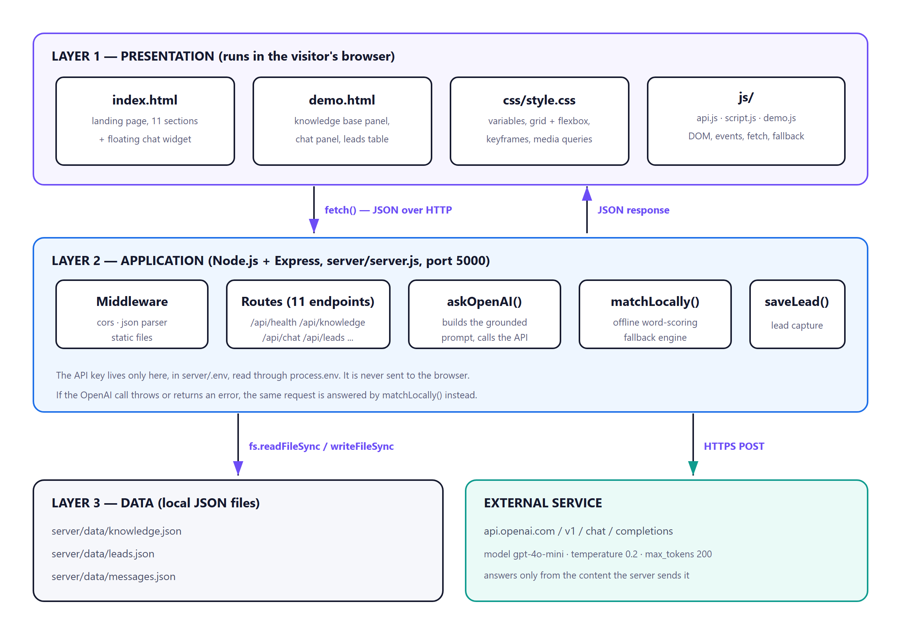
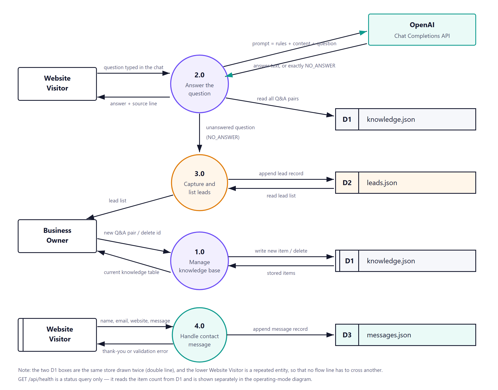
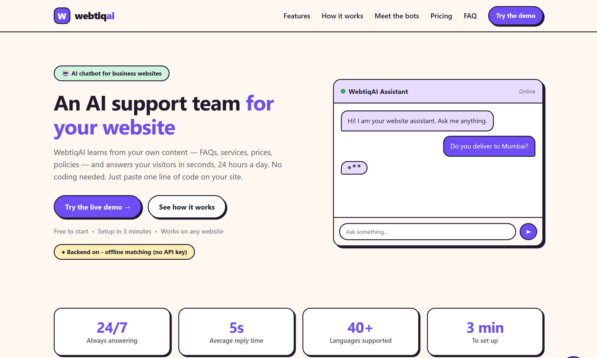
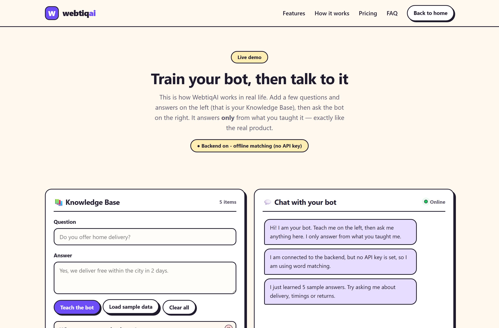
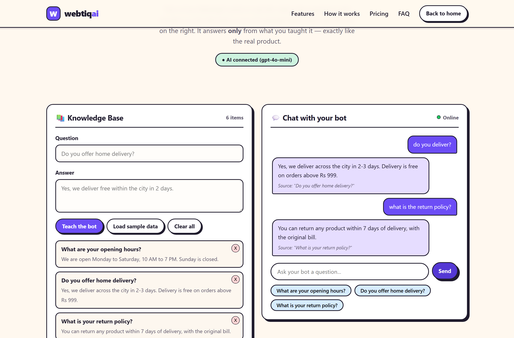
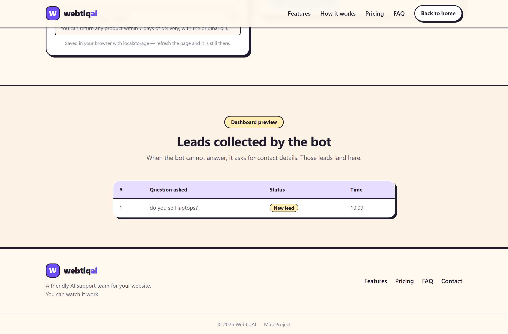
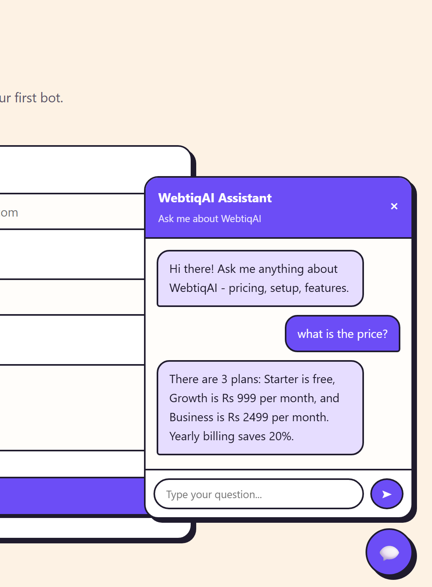
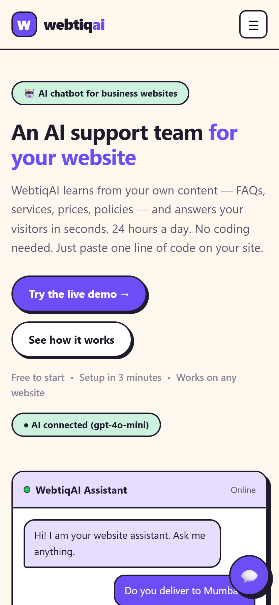

<div align="center">


<a href="https://github.com/Nikhil2-9/webtiq-ai">
  
</a>

<br/>


</div>

---

## 🎬 See it working

> Real recording. The bot is taught five answers, answers a question it was **never asked word-for-word**, shows its **source**, then honestly refuses a question outside its knowledge and turns it into a **lead**.

<div align="center">
  
</div>

---

## 💡 The problem, and the idea

<table>
<tr>
<td width="33%" valign="top">

### 😴 A static FAQ page
Answers only the questions the owner thought of.
The visitor has to read the whole list.

</td>
<td width="33%" valign="top">

### 🤖 A keyword chatbot
Breaks the moment the visitor
phrases the question differently.

</td>
<td width="33%" valign="top">

### 🔮 A general AI chatbot
Knows nothing about *this* business —
and happily **invents** a refund policy.

</td>
</tr>
</table>

**WebtiqAI is the middle path.** The business pastes its own questions and answers into a knowledge base. That content plus the visitor's question go to the language model with one hard rule:

```
Answer ONLY using the content below. Never invent facts, prices or policies.
If the answer is not in the content, reply with exactly: NO_ANSWER
```

If the reply is `NO_ANSWER`, the visitor gets an honest *"I haven't been taught that"* — and the question is saved as a **lead**, which is exactly the list of things customers want to know and the website doesn't say yet.

---

## ✨ Features

| | Feature | What it means |
|:--:|---|---|
| 🎓 | **Train in seconds** | Type a question and an answer. That's the whole onboarding. |
| 🔒 | **Grounded answers** | The model may only use your content. No hallucinated prices. |
| 🔗 | **Source on every answer** | Each reply prints the stored question it came from. |
| 🎯 | **Honest refusal** | Says "I don't know" instead of guessing — on purpose. |
| 📥 | **Automatic lead capture** | Every unanswered question lands in the leads table with a timestamp. |
| 🛡️ | **Key never reaches the browser** | It lives in `server/.env` and is read through `process.env`. |
| 📴 | **Three operating modes** | Works with AI, without AI, and with no server at all. |
| 📱 | **Fully responsive** | Breakpoints at 980px and 680px. No separate mobile page. |
| 🧼 | **XSS-safe rendering** | All user text goes in via `textContent`, never `innerHTML`. |
| 🪶 | **Zero dependencies on the front end** | No React, no Tailwind, no bundler, no build step. |

---

## 🚦 Three modes — the demo can't break

<div align="center">

| | Mode | When | Answers come from | Badge |
|:--:|---|---|---|:--:|
| 1️⃣ | **Full AI** | Server running + API key | OpenAI `gpt-4o-mini`, grounded | 🟢 `AI connected` |
| 2️⃣ | **Server only** | Server running, no key | Word-scoring engine inside the server | 🟡 `offline matching` |
| 3️⃣ | **Browser only** | No server at all | The same matching in JS + `localStorage` | ⚪ `browser mode` |

</div>

On load, the page calls `GET /api/health`, picks a mode, and **prints it honestly** in a badge at the top. Pull the plug on the server mid-demo and the site keeps answering.

---

## 🏗️ Architecture

<div align="center">
  
</div>

```
Browser  ──fetch/JSON──▶  Express (port 5000)  ──fs──▶  server/data/*.json
                                 │
                                 └──HTTPS + Bearer key──▶  api.openai.com
```

The browser **never** talks to OpenAI. It only talks to its own server, and the key never leaves that server.

<details>
<summary><b>📊 Data flow diagram (level 1)</b></summary>
<br/>
<div align="center"></div>
</details>

---

## ⚡ Quick start

```bash
# 1. install (first time only)
cd server
npm install

# 2. add your key
#    open server/.env and paste:
#    OPENAI_API_KEY=sk-proj-xxxxxxxx

# 3. run
npm start
```

Open **<http://localhost:5000>** — the server serves the website too, so no Live Server needed.

> **No key?** Everything still works. The backend falls back to its own word-matching engine and the badge says so.

```bash
# quick check from the terminal
curl http://localhost:5000/api/health
curl -X POST http://localhost:5000/api/chat \
     -H "Content-Type: application/json" \
     -d "{\"message\":\"do you deliver?\"}"
```

---

## 🔌 API

| Method | Endpoint | What it does |
|:--|:--|:--|
| `GET` | `/api/health` | Is the server up, and is a key set? |
| `GET` | `/api/knowledge` | Everything the bot knows |
| `POST` | `/api/knowledge` | Teach the bot — `{ q, a }` |
| `DELETE` | `/api/knowledge/:id` | Forget one item |
| `DELETE` | `/api/knowledge` | Clear the knowledge base |
| `POST` | `/api/knowledge/sample` | Load five sample answers |
| `POST` | `/api/chat` | Ask the business bot — `{ message }` |
| `POST` | `/api/site-chat` | The floating widget, about WebtiqAI itself |
| `GET` | `/api/leads` | Questions the bot could not answer |
| `DELETE` | `/api/leads` | Clear the lead list |
| `POST` | `/api/contact` | Save a contact-form submission |

<details>
<summary><b>🧠 How one answer is actually produced</b></summary>

```js
// 1. read every stored pair
const knowledge = readData(FILES.knowledge);

// 2. turn it into one block of content
const content = knowledge
  .map((item, i) => `${i + 1}. Q: ${item.q}\n   A: ${item.a}`)
  .join("\n");

// 3. rules + content in the SYSTEM message, question in the USER message
messages: [
  { role: "system", content: systemPrompt },   // "answer ONLY from the content..."
  { role: "user",   content: question }
],
temperature: 0.2,   // low  -> factual and repeatable, not creative
max_tokens: 200     // short answers, small bill

// 4. the reply decides what happens next
if (answer.includes("NO_ANSWER")) { saveLead(message); /* honest refusal */ }
else                              { /* answer + its source question */ }
```

If that call throws for **any** reason — no key, no internet, rate limit, bad response — the same request falls through to `matchLocally()` and the visitor still gets a reply.

</details>

<details>
<summary><b>🔍 The offline fallback engine</b></summary>

```js
cleanWords("do you deliver?")        // lowercase, strip punctuation,
  // -> ["deliver"]                  // drop stop words (do, you, the, is ...)

// score every stored item
exact word match                     // +2
word starts with the same stem       // +1

return bestScore >= 2 ? best : null; // below the threshold = "I don't know"
```

The **threshold** is the whole point: without it the bot would always return the least-bad item instead of admitting it doesn't know.

</details>

---

## 📸 Screenshots

<div align="center">
  
  <br/><sub><b>Landing page — the hero chat plays by itself</b></sub>
</div>

<br/>

<table>
<tr>
<td width="50%"><br/><sub align="center"><b>Train the bot</b></sub></td>
<td width="50%"><br/><sub><b>An answer, with its source line</b></sub></td>
</tr>
<tr>
<td width="50%"><br/><sub><b>Unanswered questions become leads</b></sub></td>
<td width="50%"><br/><sub><b>The floating chat widget</b></sub></td>
</tr>
</table>

<details>
<summary><b>📱 Mobile view</b></summary>
<br/>
<div align="center"></div>
</details>

---

## 📁 Project structure

```
webtiq-ai/
├── index.html                  landing page — 11 sections
├── demo.html                   live demo — train, chat, leads
├── css/style.css               16 numbered sections, CSS variables, Grid + Flexbox
├── js/
│   ├── api.js                  the only file that talks to the backend
│   ├── script.js               menu, hero demo, counters, pricing, FAQ, form, widget
│   └── demo.js                 knowledge base, chat, leads  (+ offline fallback)
├── server/
│   ├── server.js               the whole backend — 11 endpoints
│   ├── .env.example            copy to .env and add your key
│   └── data/                   JSON "database", created automatically
│       ├── knowledge.json      what the bot knows
│       ├── leads.json          what it couldn't answer
│       └── messages.json       contact form submissions
├── assets/                     README demo GIF and screenshots
├── notes/                      source of the study notes
├── report_build/               sources that regenerate the project report
└── ppt_build/                  sources that regenerate the presentation
```

---

## 📚 Documentation included

| File | What's inside |
|:--|:--|
| 📘 `WebtiqAI_Project_Report.docx` / `.pdf` | 56-page project report — feasibility, ER, DFD, schema, implementation, 26 test cases, screenshots |
| 📗 `WebtiqAI_Notes_and_Viva_Guide.pdf` | 42-page study notes with diagrams + viva questions |
| 📊 `WebtiqAI_Presentation.pptx` | 15-slide animated deck |
| 📄 `WebtiqAI_Front_Page.docx` | Report cover page |

---

## 🧪 Concepts demonstrated

<table>
<tr><td valign="top" width="50%">

**Front end**
- Semantic HTML5, `data-*` attributes, ARIA labels
- CSS custom properties, Grid **vs** Flexbox
- `@keyframes`, transitions, media queries
- DOM manipulation with `createElement` / `textContent`
- Events: click, submit, scroll
- Regex form validation
- `fetch()`, promises, `async`/`await`
- `IntersectionObserver`, `setTimeout` / `setInterval`
- `localStorage` as an offline fallback

</td><td valign="top" width="50%">

**Back end**
- Node.js + Express 4, middleware pipeline, order matters
- REST routing, correct HTTP status codes
- `express.json()`, `cors()`, `express.static()`
- Environment variables via `dotenv`
- File handling with `fs` as a JSON database
- Third-party API integration over HTTPS
- Prompt engineering and grounding (simple RAG)
- `try`/`catch` with a graceful fallback path
- Server-side validation that never trusts the client

</td></tr>
</table>

---

## 🔭 Future scope

`Accounts & auth` · `PostgreSQL instead of JSON` · `Crawl the customer's site to train automatically` · `Vector embeddings for semantic search` · `A real embeddable iframe widget` · `Analytics dashboard` · `Email / WhatsApp alerts on a new lead` · `Hindi + Hinglish support` · `Live human handover over WebSockets` · `Deploy with rate limiting`

---

## 👥 Team

<div align="center">

| | | |
|:--:|:--:|:--:|
| **Ishika Mittal** | **Nikhil Sharma** | **Ojasvi Garg** |

Master of Computer Applications (MCA) — Semester I
Front End Web Development (26CA205PCB) · Academic Session 2026–27
Department of Computer Applications
**KIET Deemed to be University**, Delhi-NCR, Ghaziabad

*Under the supervision of* **Dr. Shashank Bhardwaj**, Associate Professor

</div>

---

<div align="center">

### ⭐ The one rule this whole project is built on

> **A bot that says "I don't know" costs you nothing.**
> **A bot that invents a delivery charge costs you a customer.**


</div>
